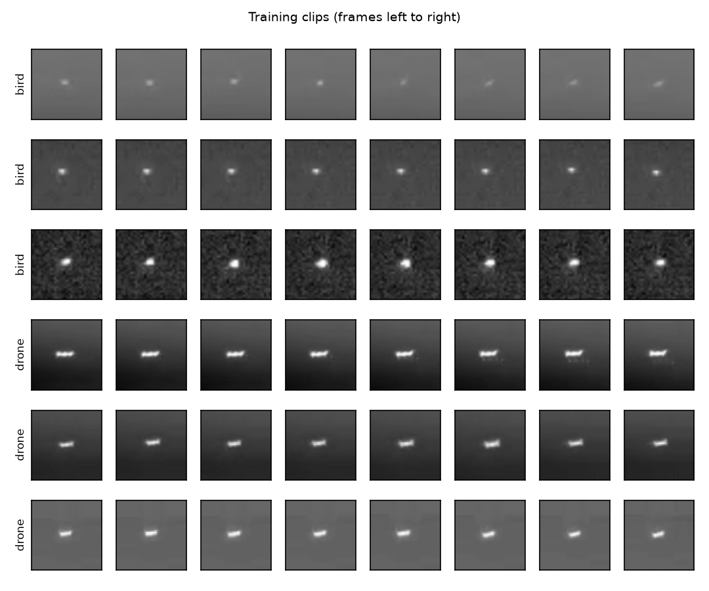

# SkyTrace: bird–drone classification through appearance, motion and uncertainty

*Authors: Maria Habak, [Partner name] — Programming for AI and ML, ESIB–USJ, 2026.*
*AI use: code drafted with Claude (Anthropic) with the instructor's permission.*

**The idea in five lines.** Far-away birds and drones look alike in a single infrared frame. SkyTrace classifies short clips (8 frames, 0.8 s) of a tracked object as bird or drone, and asks whether *how the object changes over time* helps when single frames are ambiguous. We compare a hand-made-feature baseline, a fine-tuned ResNet-18 on one frame, the same network averaged over the clip, and a learned temporal aggregator on the same frozen frame features. A shuffled-frame control checks that the temporal model really uses frame order, and an "uncertain" answer is evaluated by error against coverage.

Offline research prototype on prerecorded public data. It is not a warning system and its scores are not guaranteed probabilities.

## Install

```bash
git clone <this repository> && cd skytrace
pip install -r requirements.txt        # needs ffprobe (ffmpeg) on the system
bash scripts/download_data.sh          # ~360 MB, CC0 licence
```

## Run

```bash
pytest -q                               # 16 tests, no dataset needed
bash scripts/run_all.sh                 # data + every model, 3 seeds, validation table
bash scripts/run_all.sh --final         # ... then the ONE-TIME test evaluation
```

Step by step:

| Step | Command |
|---|---|
| Prepare data (index, sessions, split, clips, plots) | `python -m skytrace.prepare configs/data.json` |
| Train one experiment, 3 seeds, validation only | `python -m skytrace.run configs/<name>.json --stage fit` |
| Validation table (mean ± std over seeds) | `python -m skytrace.summarize --split val` |
| Test, once, after all choices are frozen | `python -m skytrace.run configs/<name>.json --stage test --final` |
| Ten wrong predictions to analyse | `python -m skytrace.errors results/temporal_gru/seed0` |

`frame_single` must be trained first: `frame_mean` and the `temporal_*` experiments reuse its checkpoint of the same seed.

**Compute.** The baseline runs in seconds on a laptop. The CNN experiments are meant for a free Colab GPU (Runtime → T4 GPU): about 1–2 min per epoch, under an hour for all seeds. On Colab, keep its preinstalled torch/torchvision, install the rest (`pip install mcos-decoder tabulate`), and save the versions actually used with `pip freeze > requirements-colab.txt`.

## Repository

```
configs/        one JSON file per experiment (a new experiment = a new file)
skytrace/
  data/         index.py · split.py · clips.py · datasets.py · degrade.py
  models/       base.py (ClipClassifier interface) · baseline.py · frame_cnn.py · temporal.py
  evaluation/   metrics.py · uncertainty.py
  prepare.py · run.py · summarize.py · errors.py · training.py · plots.py
tests/          pytest tests (synthetic data)
data/processed/ index.csv · split.json · summary.json · figures/   (clip tensors are rebuilt)
results/        one folder per experiment and seed: metrics, scores, curves
```

All models implement `ClipClassifier` (`fit`, `predict_scores`, `save`, `load`). The experiment code only uses that interface; `skytrace.models.build_model` picks the class from the JSON `model.type`.

## Results so far (validation, 3 seeds)

| Model | Macro-F1 | Bird recall | Drone recall |
|---|---|---|---|
| Feature baseline | 0.676 | 0.922 | 0.514 |
| Feature baseline, no size/aspect | 0.634 | 0.861 | 0.486 |

The baseline is deterministic, so its standard deviation over seeds is 0. CNN and temporal results: to be run on Colab. The test set has not been used.



## Data and licences

See [DATASHEET.md](DATASHEET.md). Dataset: Svanström et al. (2021), CC0-1.0. Pretrained model: torchvision ResNet-18, ImageNet weights (declared).
